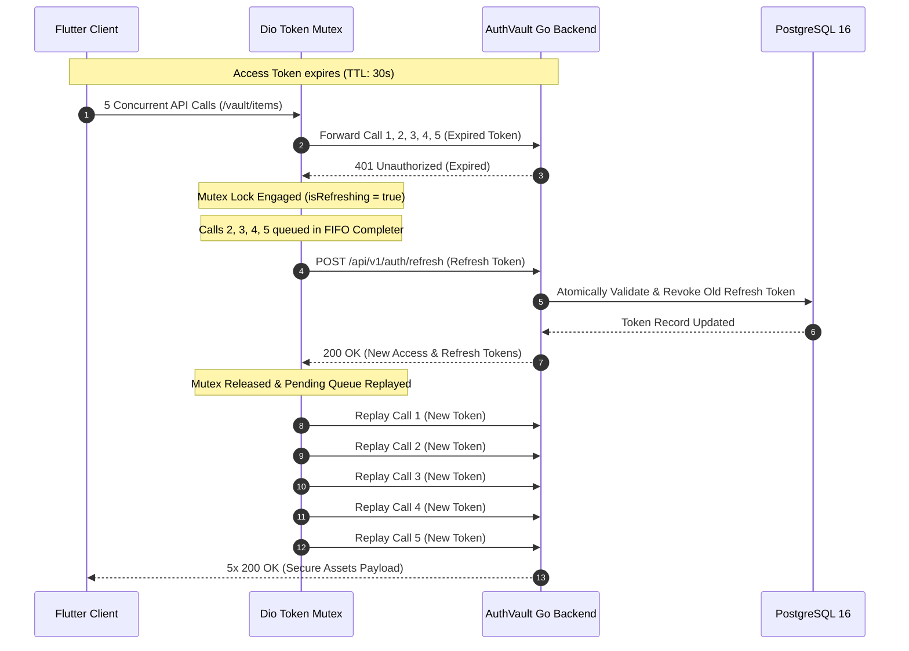
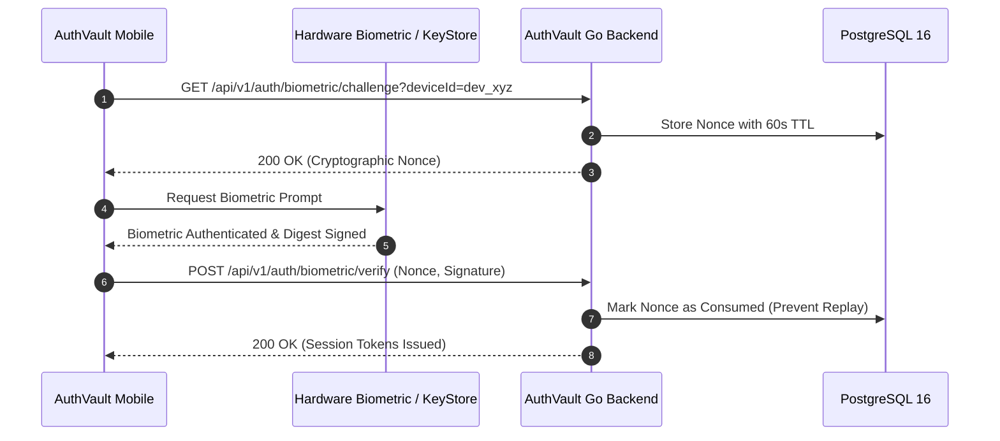

# AuthVault

<p align="center">
  
  
  
  
  
  
</p>

<p align="center">
  <strong>Enterprise-Grade Cryptographic Mobile Authentication Vault & Identity Gateway</strong><br>
  Engineered for Banking, Fintech, and High-Security Mobile Environments.
</p>

---

## Language Selection / Ngôn Ngữ
- [English Documentation](#english-documentation)
- [Tài Liệu Tiếng Việt](#tài-liệu-tiếng-việt)

---

# English Documentation

## Table of Contents
- [Overview](#overview)
- [Defense-in-Depth Security Matrix](#defense-in-depth-security-matrix)
- [System Architecture & Sequence](#system-architecture--sequence)
  - [1. Token Refresh Mutex Handshake](#1-token-refresh-mutex-handshake)
  - [2. Biometric Challenge-Response Handshake](#2-biometric-challenge-response-handshake)
- [Technology Stack](#technology-stack)
- [Repository Structure](#repository-structure)
- [Quick Start Guide](#quick-start-guide)
  - [Run Backend & Database (Windows 1-Click / 1-Command)](#run-backend--database-windows-1-click--1-command)
  - [Run Backend & Database (Linux / macOS / Git Bash)](#run-backend--database-linux--macos--git-bash)
  - [Docker CLI Flags Reference](#docker-cli-flags-reference)
  - [Verify Integration Tests](#verify-integration-tests)
  - [Run Mobile Client (Flutter)](#run-mobile-client-flutter)
- [Default Test Credentials](#default-test-credentials)
- [Security Compliance & Mitigations](#security-compliance--mitigations)
- [License](#license)

---

## Overview

**AuthVault** provides an end-to-end identity verification and secure asset management ecosystem. Combining a high-performance **Go (Gin)** backend, dedicated **PostgreSQL** storage in Docker, and a **Flutter** client built on **Feature-First Clean Architecture**, AuthVault eliminates common mobile attack vectors including token race conditions, shoulder surfing, inactivity hijacking, and physical keypad sniffing.

---

## Defense-in-Depth Security Matrix

| Layer | Threat Vector | Mitigation Strategy | Implementation |
| :--- | :--- | :--- | :--- |
| **Layer 1** | Token Expiration Race Condition | Concurrency Mutex FIFO Queue with automatic request replay | `restful_request.dart` (Dio Interceptor) |
| **Layer 2** | Shoulder Surfing & App Switcher Leaks | Native OS privacy blur curtain activated on backgrounding | `app_lifecycle_privacy_observer.dart` |
| **Layer 3** | Inactivity Hijacking on Lost Device | Hardware touch listener with 120s rolling timeout | `session_timeout_manager.dart` |
| **Layer 4** | Physical Keypad Smudge / Sniffing | Dynamic numpad shuffling digits 0–9 on each render | `scrambled_numpad.dart` |
| **Layer 5** | Host Environment Compromise | Heuristic detection for Root, Jailbreak, Emulators, Debuggers | `device_integrity_checker.dart` |
| **Layer 6** | Biometric Replay Attacks | Server-issued one-time cryptographic nonces (TTL: 60s) | `biometric_crypto_service.dart` + Go Service |

---

## System Architecture & Sequence

### 1. Token Refresh Mutex Handshake

When multiple concurrent requests encounter an expired JWT access token, AuthVault activates a mutex lock, pauses incoming requests in a FIFO Completer queue, performs exactly **one** refresh rotation, and replays all pending requests transparently.



---

### 2. Biometric Challenge-Response Handshake

AuthVault avoids naive boolean-based local biometric checks by issuing cryptographic server nonces verified via hardware keystore digest signatures.



---

## Technology Stack

| Domain | Technology | Purpose |
| :--- | :--- | :--- |
| **Mobile Client** | Flutter 3.44+ / Dart 3.9+ | Cross-platform mobile client (Android / iOS) |
| **State Management** | `flutter_bloc` / Cubit | Predictable reactive state management |
| **Navigation** | `go_router` | Declarative routing with auth redirection |
| **Networking** | `dio` | HTTP client with FIFO token refresh mutex interceptor |
| **Local Storage** | `flutter_secure_storage` | EncryptedSharedPreferences (Android) / Keychain (iOS) |
| **Backend API** | Go 1.22+ (`gin-gonic/gin`) | High-throughput REST API server |
| **Database** | PostgreSQL 16 (Custom Docker) | Relational storage with ACID row-locking |
| **Containers** | Docker & Docker Compose | Multi-container orchestration (`authvault-db` + `authvault-backend`) |

---

## Repository Structure

```text
FlutterSecureAuthVault/
├── docker-compose.yml              # Multi-container orchestration (DB + API)
├── run_docker.bat                  # 1-Click / 1-Command Windows Docker launcher
├── run_docker.sh                   # Unix / Git Bash Docker runner shortcut
├── database/                       # Custom PostgreSQL 16 container setup
│   ├── Dockerfile                  # Database Dockerfile
│   └── init/
│       ├── 01_schema.sql           # DDL: users, tokens, challenges, vault, audit
│       └── 02_seed.sql             # Seed data with security officer & vault assets
├── server/                         # Go Backend Service
│   ├── Dockerfile                  # Multi-stage Alpine container
│   ├── cmd/api/main.go             # API Gateway entrypoint (port 8080)
│   └── internal/
│       ├── config/                 # Environment & JWT configuration
│       ├── handlers/               # REST HTTP endpoints
│       ├── middleware/             # JWTAuth, CORS, Security headers
│       ├── models/                 # Request/Response DTOs
│       ├── services/               # Token rotation & challenge engines
│       └── store/                  # PostgreSQL store with row-locking
├── auth_vault/                     # Flutter Mobile Application
│   ├── pubspec.yaml                # Mobile dependencies
│   ├── lib/
│   │   ├── main.dart               # App initialization with lifecycle observers
│   │   └── src/
│   │       ├── common/             # UI Colors, Themes, GetIt DI container
│   │       ├── core/               # RestfulRequest, BaseResponse, LiveData
│   │       │   └── security/       # Privacy curtain, timeout manager, integrity
│   │       ├── shared/             # GoRouter configuration & navigation keys
│   │       └── features/
│   │           ├── auth/           # Login screen, AuthCubit, AuthRepository
│   │           ├── pin_fallback/   # Scrambled dynamic numpad
│   │           └── dashboard/      # Encrypted assets dashboard & concurrent test
│   └── test/                       # Unit, widget, and security test suite
└── scripts/
    ├── docker_run.sh               # Full-featured Bash script for Docker lifecycle
    └── test_docker_backend.ps1     # Automated 7-step backend integration test
```

---

## Quick Start Guide

### Run Backend & Database (Windows 1-Click / 1-Command)

On Windows, launch the entire backend and database with a **single command** or **single click**:

#### Option 1: Execute single command in Command Prompt or PowerShell
```cmd
run_docker.bat -d
```
*(Automatically detects Git Bash or Docker Compose and runs in detached mode).*

#### Option 2: Run `.sh` script directly via PowerShell
```powershell
& "C:\Program Files\Git\bin\bash.exe" scripts/docker_run.sh -d
```

#### Option 3: Double-click launcher
> Simply open the project root directory and double-click **`run_docker.bat`**.

---

### Run Backend & Database (Linux / macOS / Git Bash)

For Linux, macOS, or Git Bash on Windows:

```bash
# Grant execution permissions (first-time only)
chmod +x run_docker.sh scripts/docker_run.sh

# Start services in detached mode
./run_docker.sh -d
```

---

### Docker CLI Flags Reference

Both `run_docker.bat` and `run_docker.sh` support standard operation flags:

| Flag / Option | Description |
| :--- | :--- |
| `-d`, `--detach` | Run containers in background |
| `-b`, `--build` | Force rebuild Docker images before launching |
| `-s`, `--stop` | Stop all active project containers |
| `--down` | Stop and remove all containers and network bridge |
| `-v`, `--volumes` | Prune named volumes alongside teardown (pair with `--down`) |
| `-r`, `--restart` | Restart all project services |
| `-l`, `--logs` | Stream real-time container log output |
| `-p`, `--ps` | Check service runtime status |
| `-h`, `--help` | Show command helper |

**Usage Examples:**
```bash
# Rebuild and start in background
./run_docker.sh -d -b

# Check service status
./run_docker.sh -p

# Follow logs live
./run_docker.sh -l

# Stop services
./run_docker.sh -s
```

---

### Verify Integration Tests

Run the complete 7-stage automated backend security suite (Healthcheck, Auth, Token Rotation, Nonce Challenge, Replay Rejection):

```powershell
powershell -ExecutionPolicy Bypass -File scripts/test_docker_backend.ps1
```

---

### Run Mobile Client (Flutter)

Navigate to the `auth_vault` directory:

```bash
cd auth_vault

# 1. Run static analysis (Zero errors/warnings)
flutter analyze

# 2. Run test suites (Unit, Widget & Concurrency tests)
flutter test

# 3. Launch application on target device or emulator
flutter run
```

---

## Default Test Credentials

Pre-seeded authentication accounts available in the database:

| Account Role | Username | Password | Scrambled PIN | Permissions |
| :--- | :--- | :--- | :--- | :--- |
| **Security Officer** | `admin` | `admin123` | `123456` | Full administrative & vault access |
| **Fintech Operator** | `operator` | `operator123` | `654321` | Sensitive asset catalog viewing |

---

## Security Compliance & Mitigations

Engineered in alignment with OWASP Mobile Top 10 recommendations:

- **M1: Improper Platform Usage** $\rightarrow$ Hardware-backed Android EncryptedSharedPreferences & iOS Keychain via `flutter_secure_storage`.
- **M2: Insecure Data Storage** $\rightarrow$ Zero plain-text credentials in storage; runtime memory cleared upon inactivity timeout.
- **M3: Insecure Communication** $\rightarrow$ Recommended TLS 1.3 pinning for production environments.
- **M4: Insecure Authentication** $\rightarrow$ Token rotation enforced; immediate invalidation of revoked refresh tokens.
- **M8: Security Misconfiguration** $\rightarrow$ Proactive heuristics detecting rooted devices, jailbreaks, and debuggers.
- **M9: Reverse Engineering** $\rightarrow$ Randomized scrambled numeric keypad prevents physical smudge & screen tap analysis.

---

## License

This project is licensed under the MIT License - see the [LICENSE](LICENSE) file for details.

---
---

# Tài Liệu Tiếng Việt

## Mục Lục
- [Tổng Quan Dự Án](#tổng-quan-dự-án)
- [Ma Trận Bảo Mật Đa Tầng (Defense-in-Depth)](#ma-trận-bảo-mật-đa-tầng-defense-in-depth)
- [Kiến Trúc & Quy Trình Hoạt Động](#kiến-trúc--quy-trình-hoạt-động)
  - [1. Cơ Chế Token Refresh Mutex Handshake](#1-cơ-chế-token-refresh-mutex-handshake)
  - [2. Cơ Chế Xác Thực Sinh Trắc Học Challenge-Response](#2-cơ-chế-xác-thực-sinh-trắc-học-challenge-response)
- [Ngăn Xếp Công Nghệ (Tech Stack)](#ngăn-xếp-công-nghệ-tech-stack)
- [Cấu Trúc Thư Mục](#cấu-trúc-thư-mục)
- [Hướng Dẫn Khởi Động Nhanh](#hướng-dẫn-khởi-động-nhanh)
  - [Khởi Chạy Backend & Cơ Sở Dữ Liệu Trên Windows](#khởi-chạy-backend--cơ-sở-dữ-liệu-trên-windows)
  - [Khởi Chạy Trên Linux / macOS / Git Bash](#khởi-chạy-trên-linux--macos--git-bash)
  - [Bảng Tra Cứu Cờ Lệnh Docker Script](#bảng-tra-cứu-cờ-lệnh-docker-script)
  - [Kiểm Thử Tích Hợp Tự Động (Integration Tests)](#kiểm-thử-tích-hợp-tự-động-integration-tests)
  - [Khởi Chạy Ứng Dụng Flutter Mobile](#khởi-chạy-ứng-dụng-flutter-mobile)
- [Tài Khoản Kiểm Thử Mặc Định](#tài-khoản-kiểm-thử-mặc-định)
- [Tuân Thủ Tiêu Chuẩn Bảo Mật OWASP](#tuân-thủ-tiêu-chuẩn-bảo-mật-owasp)
- [Giấy Phép](#giấy-phép)

---

## Tổng Quan Dự Án

**AuthVault** là giải pháp xác thực danh tính và quản lý tài sản bảo mật toàn diện (end-to-end). Kết hợp giữa backend **Go (Gin)** hiệu năng cao, hệ quản trị cơ sở dữ liệu **PostgreSQL** trong Docker, cùng ứng dụng di động **Flutter** xây dựng theo mô hình **Feature-First Clean Architecture**, AuthVault loại bỏ hoàn toàn các rủi ro bảo mật thường gặp trên di động như xung đột refresh token (race conditions), nhìn lén màn hình (shoulder surfing), chiếm đoạt phiên khi không tương tác và nghe lén bàn phím vật lý.

---

## Ma Trận Bảo Mật Đa Tầng (Defense-in-Depth)

| Tầng | Nguy Cơ Tấn Công | Chiến Lược Giảm Thiểu | File Triển Khai |
| :--- | :--- | :--- | :--- |
| **Tầng 1** | Xung đột làm mới Token (Race Condition) | Hàng đợi Mutex FIFO chống nghẽn với cơ chế tự phát lại request | `restful_request.dart` (Dio Interceptor) |
| **Tầng 2** | Nhìn lén & Lộ dữ liệu trong App Switcher | Lớp màng mờ bảo mật native tự kích hoạt khi chuyển ứng dụng xuống nền | `app_lifecycle_privacy_observer.dart` |
| **Tầng 3** | Chiếm đoạt phiên làm việc khi bỏ quên máy | Lắng nghe thao tác chạm phần cứng, tự khóa sau 120 giây không dùng | `session_timeout_manager.dart` |
| **Tầng 4** | Phân tích vệt vân tay / Quay lén bàn phím | Bàn phím số động tự động xáo trộn vị trí 0–9 sau mỗi lần mở | `scrambled_numpad.dart` |
| **Tầng 5** | Môi trường hệ điều hành bị can thiệp | Heuristic kiểm tra thiết bị Root, Jailbreak, Giả lập, Trình gỡ lỗi | `device_integrity_checker.dart` |
| **Tầng 6** | Tấn công phát lại sinh trắc (Replay Attack) | Chuỗi Nonce mã hóa dùng một lần cấp từ server (Thời gian sống: 60s) | `biometric_crypto_service.dart` + Go Service |

---

## Kiến Trúc & Quy Trình Hoạt Động

### 1. Cơ Chế Token Refresh Mutex Handshake

Khi nhiều request đồng thời gặp lỗi JWT Access Token hết hạn, AuthVault kích hoạt khóa Mutex, tạm dừng các request kế tiếp vào hàng đợi `Completer` theo cơ chế FIFO, chỉ thực hiện duy nhất **1 lần gọi refresh**, sau đó tự động phát lại (replay) toàn bộ các request đã đợi.

---

### 2. Cơ Chế Xác Thực Sinh Trắc Học Challenge-Response

AuthVault không sử dụng cơ chế kiểm tra boolean `true/false` đơn giản ở client, mà sử dụng chuỗi Nonce ngẫu nhiên từ server và yêu cầu ký số bằng phần cứng Keystore/Enclave trước khi cấp phiên làm việc.

---

## Ngăn Xếp Công Nghệ (Tech Stack)

| Hạng Mục | Công Nghệ | Vai Trò & Mục Đích |
| :--- | :--- | :--- |
| **Mobile Client** | Flutter 3.44+ / Dart 3.9+ | Ứng dụng di động đa nền tảng (Android & iOS) |
| **Quản Lý Trạng Thái** | `flutter_bloc` / Cubit | Quản lý state theo mô hình phản ứng dự đoán được |
| **Điều Hướng** | `go_router` | Định tuyến khai báo kèm luồng kiểm tra quyền tự động |
| **Giao Tiếp Mạng** | `dio` | HTTP client tích hợp Interceptor khóa hàng đợi Mutex FIFO |
| **Lưu Trữ Cục Bộ** | `flutter_secure_storage` | EncryptedSharedPreferences (Android) / Keychain (iOS) |
| **Backend API** | Go 1.22+ (`gin-gonic/gin`) | Máy chủ REST API thông lượng cao, tiêu tốn ít tài nguyên |
| **Cơ Sở Dữ Liệu** | PostgreSQL 16 (Docker) | Lưu trữ quan hệ đảm bảo chuẩn ACID và khóa mức dòng (row-level locking) |
| **Ảo Hóa / Container** | Docker & Docker Compose | Đóng gói và chạy đồng bộ hệ thống (`authvault-db` + `authvault-backend`) |

---

## Cấu Trúc Thư Mục

Cấu trúc mã nguồn được phân chia rành mạch giữa Backend (Go), Database (SQL/PostgreSQL) và Mobile (Flutter Clean Architecture theo Feature):

```text
FlutterSecureAuthVault/
├── docker-compose.yml              # Điều phối container (Database + Backend API)
├── run_docker.bat                  # Script chạy nhanh 1-Click trên Windows
├── run_docker.sh                   # Script chạy trên Linux / macOS / Git Bash
├── database/                       # Cấu hình container PostgreSQL 16
│   ├── Dockerfile                  # Dockerfile cho Database
│   └── init/
│       ├── 01_schema.sql           # Cấu trúc bảng: users, tokens, challenges, vault, audit
│       └── 02_seed.sql             # Dữ liệu mẫu khởi tạo ban đầu
├── server/                         # Dịch vụ Backend viết bằng Go
│   ├── Dockerfile                  # Build đa tầng (Multi-stage) trên nền Alpine siêu nhẹ
│   ├── cmd/api/main.go             # Điểm khởi chạy API Gateway (cổng 8080)
│   └── internal/
│       ├── config/                 # Cấu hình biến môi trường & JWT
│       ├── handlers/               # Xử lý các HTTP endpoint
│       ├── middleware/             # Middleware xác thực JWT, CORS, Security headers
│       ├── models/                 # Cấu trúc dữ liệu DTO
│       ├── services/               # Logic xoay vòng token & xử lý challenge
│       └── store/                  # Truy vấn PostgreSQL với row-locking
├── auth_vault/                     # Ứng dụng di động Flutter
│   ├── pubspec.yaml                # Khai báo dependencies
│   ├── lib/
│   │   ├── main.dart               # Điểm bắt đầu app kèm trình theo dõi vòng đời
│   │   └── src/
│   │       ├── common/             # Theme, màu sắc, cấu hình GetIt Dependency Injection
│   │       ├── core/               # RestfulRequest, BaseResponse, LiveData
│   │       │   └── security/       # Màn hình bảo mật, timeout, kiểm tra tính toàn vẹn máy
│   │       ├── shared/             # Cấu hình GoRouter & Navigation keys
│   │       └── features/
│   │           ├── auth/           # Màn hình đăng nhập, AuthCubit, AuthRepository
│   │           ├── pin_fallback/   # Bàn phím số ngẫu nhiên chống nhìn trộm
│   │           └── dashboard/      # Kho tài sản mã hóa & kiểm thử gọi API đồng thời
│   └── test/                       # Bộ kiểm thử Unit, Widget và Security tests
└── scripts/
    ├── docker_run.sh               # Script Bash quản lý toàn diện vòng đời Docker
    └── test_docker_backend.ps1     # Script PowerShell tự động kiểm thử 7 bước Backend
```

---

## Hướng Dẫn Khởi Động Nhanh

### Khởi Chạy Backend & Cơ Sở Dữ Liệu Trên Windows

Người dùng Windows có thể khởi chạy toàn bộ Backend và Database chỉ với **1 cú click chuột** hoặc **1 câu lệnh duy nhất**:

#### Cách 1: Chạy 1 câu lệnh trong Command Prompt hoặc PowerShell
```cmd
run_docker.bat -d
```
*(Script tự động nhận diện Git Bash hoặc Docker Compose và chạy toàn bộ dịch vụ ngầm).*

#### Cách 2: Chạy trực tiếp script `.sh` qua PowerShell (1 dòng lệnh)
```powershell
& "C:\Program Files\Git\bin\bash.exe" scripts/docker_run.sh -d
```

#### Cách 3: Double-click chuột
> Mở thư mục dự án và nhấp đúp vào file **`run_docker.bat`**.

---

### Khởi Chạy Trên Linux / macOS / Git Bash

Dành cho môi trường Linux, macOS hoặc Git Bash:

```bash
# Cấp quyền thực thi file (chỉ cần làm ở lần đầu)
chmod +x run_docker.sh scripts/docker_run.sh

# Chạy dịch vụ ở chế độ chạy nền (detached)
./run_docker.sh -d
```

---

### Bảng Tra Cứu Cờ Lệnh Docker Script

Cả `run_docker.bat` và `run_docker.sh` đều hỗ trợ các tham số dòng lệnh sau:

| Cờ Lệnh | Ý Nghĩa & Tác Dụng |
| :--- | :--- |
| `-d`, `--detach` | Khởi chạy container ở chế độ chạy nền (background) |
| `-b`, `--build` | Tự động build lại Docker image trước khi khởi động |
| `-s`, `--stop` | Dừng các container đang hoạt động |
| `--down` | Dừng và xóa toàn bộ container kèm network liên quan |
| `-v`, `--volumes` | Xóa luôn dữ liệu trong database volume (dùng kèm với `--down`) |
| `-r`, `--restart` | Khởi động lại toàn bộ containers |
| `-l`, `--logs` | Theo dõi logs trực tiếp theo thời gian thực (stream logs) |
| `-p`, `--ps` | Xem trạng thái hoạt động hiện tại của Backend & PostgreSQL |
| `-h`, `--help` | Hiển thị menu hướng dẫn |

**Ví dụ thực tế:**
```bash
# Build lại và khởi chạy nền
./run_docker.sh -d -b

# Kiểm tra trạng thái container
./run_docker.sh -p

# Xem log trực tiếp
./run_docker.sh -l

# Tắt toàn bộ dịch vụ
./run_docker.sh -s
```

---

### Kiểm Thử Tích Hợp Tự Động (Integration Tests)

Chạy script PowerShell tự động kiểm thử 7 kịch bản bảo mật cốt lõi của Backend:

```powershell
powershell -ExecutionPolicy Bypass -File scripts/test_docker_backend.ps1
```

---

### Khởi Chạy Ứng Dụng Flutter Mobile

Mở terminal tại thư mục `auth_vault`:

```bash
cd auth_vault

# 1. Kiểm tra tĩnh chất lượng mã nguồn
flutter analyze

# 2. Chạy toàn bộ unit test và widget test
flutter test

# 3. Khởi chạy ứng dụng lên máy thật hoặc máy ảo
flutter run
```

---

## Tài Khoản Kiểm Thử Mặc Định

Cơ sở dữ liệu đã nạp sẵn 2 tài khoản kiểm thử:

| Vai Trò | Tên Đăng Nhập | Mật Khẩu | Mã PIN Xáo Trộn | Quyền Hạn |
| :--- | :--- | :--- | :--- | :--- |
| **Sĩ quan An ninh (Admin)** | `admin` | `admin123` | `123456` | Toàn quyền kiểm soát và truy cập vault |
| **Nhân viên Vận hành** | `operator` | `operator123` | `654321` | Xem danh mục tài sản nhạy cảm |

---

## Tuân Thủ Tiêu Chuẩn Bảo Mật OWASP

Dự án được xây dựng bám sát chuẩn OWASP Mobile Top 10:

- **M1: Sử dụng Nền tảng Bất cẩn (Improper Platform Usage)** $\rightarrow$ Dữ liệu nhạy cảm lưu trong Android EncryptedSharedPreferences và iOS Keychain qua `flutter_secure_storage`.
- **M2: Lưu trữ Dữ liệu Kém An toàn (Insecure Data Storage)** $\rightarrow$ Tuyệt đối không lưu mật khẩu/PIN dạng plaintext; bộ đệm được xóa tự động khi session hết hạn.
- **M3: Truyền thông Kém An toàn (Insecure Communication)** $\rightarrow$ Khuyến nghị ghim chứng chỉ TLS 1.3 Pinning cho môi trường production.
- **M4: Cơ chế Xác thực Kém An toàn (Insecure Authentication)** $\rightarrow$ Token xoay vòng (Token Rotation); từ chối ngay lập tức khi phát hiện token cũ đã bị thu hồi.
- **M8: Cấu hình Bảo mật Sai sót (Security Misconfiguration)** $\rightarrow$ Cơ chế heuristic phát hiện thiết bị đã Root, Jailbreak hoặc đang bật Debug.
- **M9: Kỹ thuật Dịch ngược (Reverse Engineering)** $\rightarrow$ Bàn phím số PIN xáo trộn động ngăn chặn việc ghi nhận tọa độ thao tác tay hoặc dấu vết vân tay trên màn hình.

---

## Giấy Phép

Dự án được phân phối dưới giấy phép mã nguồn mở [MIT License](LICENSE).