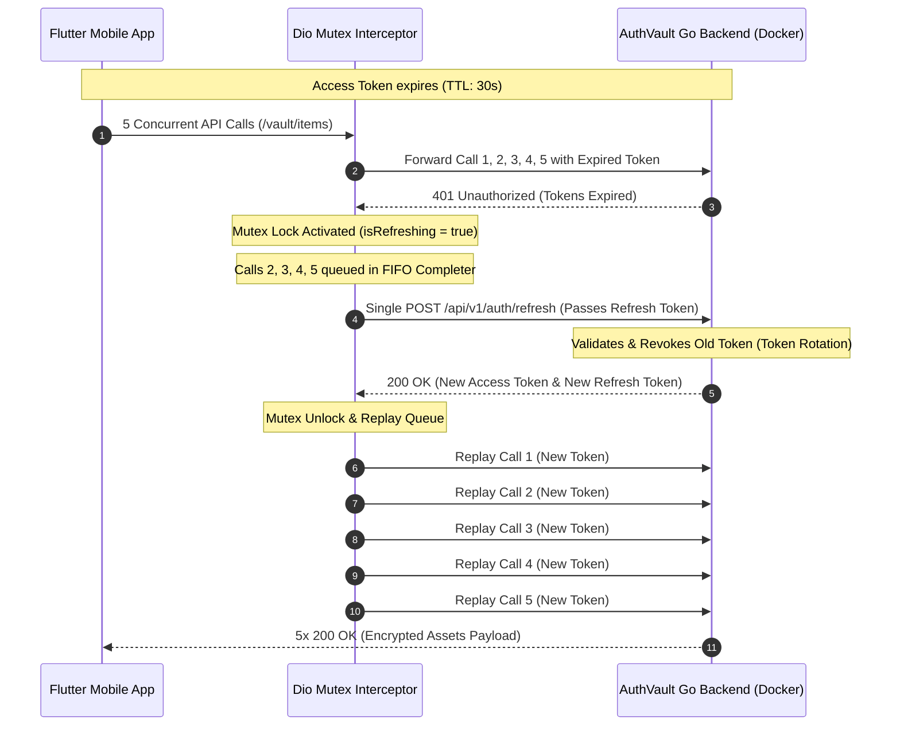
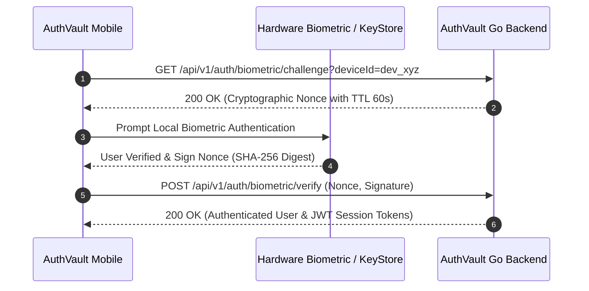

# AuthVault: Enterprise Secure Identity & Hardware-Backed Auth Hub

> **Production-grade Defense-in-Depth Security Kit for Fintech & Banking Applications.**  
> Built with Go (Gin Engine) Backend and Flutter (Feature-First Clean Architecture) Mobile Client.

---

## 1. System Overview

**AuthVault** provides an end-to-end security suite designed to eliminate the most critical mobile security vulnerabilities:
1. **Token Refresh Race Condition:** Mutex FIFO Queue guarantees that multiple concurrent requests encountering expired tokens trigger exactly **one** refresh request.
2. **App-Switcher Shoulder Surfing & Data Leakage:** Automatic privacy blur shield obscures application screenshots in the native OS recent apps list.
3. **Session Hijacking on Idle Devices:** Hardware-level touch listener resets a 120-second inactivity countdown, locking unauthorized physical access.
4. **PIN Keypad Pattern Sniffing:** Dynamic numpad shuffles digits 0 through 9 on each render with tactile haptic feedback.
5. **Host Environment Tampering:** Proactive heuristics evaluate root status, jailbreak hooks, developer debugging, and emulators.

---

## 2. Architecture & Concurrency Sequence

### A. Token Refresh Mutex Handshake (5 Concurrent Requests)



---

### B. Biometric Challenge-Response Handshake



---

## 3. Tech Stack & Engineering Standards

| Domain | Technology | Key Responsibility |
| :--- | :--- | :--- |
| **Backend API** | Go (`gin-gonic/gin`) | High-concurrency REST gateway, JWT claims validation, refresh token rotation |
| **Database** | PostgreSQL 16 (Custom Docker Image) | Dedicated container with persistent schemas, ACID row locking for token rotation |
| **Containerization** | Docker Multi-stage Alpine | Multi-container setup (`authvault-db` + `authvault-backend`) orchestrated via Compose |
| **Mobile Client** | Flutter (`flutter_bloc`, `go_router`) | Feature-First Clean Architecture conforming to `FLUTTER_ARCHITECTURE.md` |
| **Secure Storage** | `flutter_secure_storage` | Android EncryptedSharedPreferences and iOS Keychain Accessibility |
| **Biometric Gate** | `local_auth` + Crypto Digest | Nonce signature simulation & biometric prompt coordination |
| **UI Design System** | Electric Terminal Dark | Near-black canvas (`#101010`), Electric Green accent (`#00D992`), 1px hairlines (`#3D3A39`) |

---

## 4. Directory Structure

```text
FlutterSecureAuthVault/
├── docker-compose.yml              # Multi-container orchestration (DB + API)
├── database/                       # Dedicated PostgreSQL Database Image
│   ├── Dockerfile                  # Custom Postgres 16 Alpine image
│   └── init/
│       ├── 01_schema.sql           # DDL: users, tokens, challenges, vault, audit
│       └── 02_seed.sql             # Seed data with security officer & assets
├── server/                         # Go Backend (Gin)
│   ├── cmd/api/main.go             # Entrypoint on port 8080
│   ├── internal/
│   │   ├── config/                 # DB & JWT configurations
│   │   ├── handlers/               # REST controllers
│   │   ├── middleware/             # JWTAuth, CORS, Logger
│   │   ├── models/                 # Domain DTOs
│   │   ├── services/               # Token rotation & challenge engines
│   │   └── store/                  # PostgresStore & MemoryStore fallback
│   └── Dockerfile                  # Alpine multi-stage container
├── vault_pass_mobile/              # Flutter Client (AuthVault Mobile)
│   ├── lib/
│   │   ├── main.dart
│   │   └── src/
│   │       ├── common/             # UIColors, Dimen, AppConfig, GetIt injection
│   │       ├── core/               # RestfulRequest, BaseResponse, LiveData
│   │       │   └── security/       # PrivacyCurtain, SessionTimeout, IntegrityChecker
│   │       ├── shared/             # GoRouter, GlobalKeyManager
│   │       └── features/
│   │           ├── auth/           # LoginScreen, AuthCubit, AuthRepository
│   │           ├── pin_fallback/   # ScrambledNumpad (Dynamic 0-9 Shuffling)
│   │           └── dashboard/      # DashboardScreen, Concurrent 401 Trigger
└── scripts/
    └── test_docker_backend.ps1     # Automated end-to-end integration test suite
```

---

## 5. Quick Start

### A. Run Backend via Docker

```bash
# Build and run containerized Go backend on http://localhost:8080
docker compose up -d

# Verify server logs
docker logs -f authvault_backend_api
```

### B. Run Backend Integration Tests

```powershell
# Executes full 7-step test suite verifying token rotation and 401 handling
powershell -ExecutionPolicy Bypass -File scripts/test_docker_backend.ps1
```

### C. Run Mobile Client

```bash
cd vault_pass_mobile

# Check code health (Zero warnings)
flutter analyze

# Execute test suite
flutter test

# Run application on device or simulator
flutter run
```

---

## 6. Default Test Accounts

* **Security Officer:** Username: `admin` | Password: `admin123` | Scrambled PIN: `123456`
* **Fintech Operator:** Username: `operator` | Password: `operator123` | Scrambled PIN: `654321`
